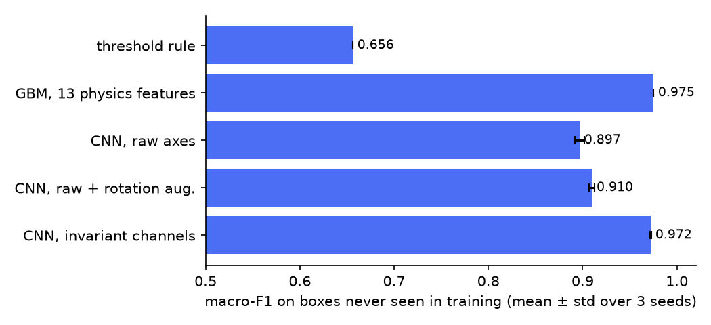
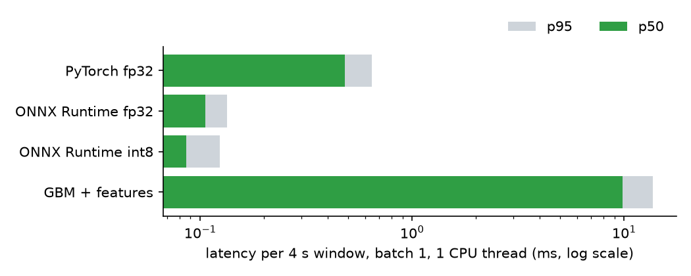

# telematics-edge-ai

**Harsh-driving detection on a telematics box that can be mounted any way round.** Five classifiers — a firmware-style threshold rule, gradient boosting on physics features, and three 1D CNNs in PyTorch — evaluated on boxes they never saw in training, then exported to ONNX and quantized to int8 for an edge CPU.

🇵🇱 *Wykrywanie ostrego hamowania, przyspieszania, zakrętów i uderzeń w nawierzchnię z akcelerometru i żyroskopu w skrzynce telematycznej zamontowanej pod dowolnym kątem. Porównanie reguły progowej, GBM na cechach fizycznych i sieci CNN (PyTorch), test na nowych urządzeniach, eksport do ONNX i kwantyzacja int8 pod urządzenia brzegowe.*


**Key results** (12 000 windows from 80 simulated boxes; test = 20 boxes never seen in training)

- A **CNN on mounting-invariant channels** reaches **0.972 macro-F1**; the same CNN on raw sensor axes **0.897**. Random-rotation augmentation helps the raw CNN only a little (0.910).
- **Gradient boosting on 13 hand-made physics features is as good (0.975)** — but runs ~100× slower per window on CPU here, because of the feature code.
- The firmware-style **threshold rule gets 0.656**: without knowing which way is forward it cannot tell braking from acceleration.
- **int8 quantization: 182 KB → 70 KB**, accuracy unchanged (99.2% of predictions identical to PyTorch), **0.09 ms p50** per 4-second window on one CPU thread.
- A **random train/test split overstates** the raw CNN: 0.953 accuracy vs 0.927 on unseen boxes.
- Almost all errors are events within 10% of the harshness threshold (78% correct there, 99.9% when the event is >25% away from it).

> The data is **simulated** (see [Data](#data)). The point of the project is the method — invariance, evaluation on unseen devices, edge export — not a claim about a specific product.

## Why this project

I have run a transport company since 2015. Fleet telematics turns accelerometer data into driver scores ("harsh braking: 14 this week") and insurance and safety decisions, and the engineering problems behind it are the same everywhere: installers mount the box at random angles, a new box must work on day one without recalibration, and the model has to run on a small CPU next to everything else the box does.

## The problem in one picture

The box measures acceleration and rotation in **its own** frame. The physics happens in the **vehicle** frame. Mounted at an unknown yaw, a braking event can appear on any horizontal axis, with any sign:

```
vehicle frame            device frame (illustration: box rotated 135°, slightly tilted)
  x: -5 m/s²   ──R──►    ax: +3.4   ay: -3.6   az: 9.8 ± 0.7
```

Two ways to deal with it:

1. **Let the model learn it** — feed raw axes, add random-rotation augmentation.
2. **Remove it before the model** — estimate gravity from the window, then compute four channels that do not depend on mounting: vertical acceleration, horizontal acceleration magnitude, yaw rate (gyro along gravity), and high-frequency vibration. `model.Invariant` does this in PyTorch, so it is **exported inside the ONNX graph** and the box feeds raw sensor data.

What still separates braking from acceleration once direction is gone: the engine vibrates harder under throttle and goes quiet when braking, and harsh braking is usually shorter. Both are in the vibration and duration channels.

## Results

### Models, on 20 boxes never seen in training



| Model | Accuracy | Macro-F1 | Notes |
|---|---:|---:|---|
| Threshold rule (firmware-style) | 0.795 | 0.656 | Calls every strong longitudinal event braking |
| GBM on 13 physics features | 0.975 | 0.975 | `HistGradientBoosting`; deterministic, so std = 0 |
| CNN, raw axes | 0.927 ± 0.004 | 0.897 ± 0.005 | 45k parameters |
| CNN, raw + random-rotation augmentation | 0.930 ± 0.002 | 0.910 ± 0.003 | |
| **CNN, invariant channels** | **0.973 ± 0.001** | **0.972 ± 0.001** | Exported model |

Mean ± std over 3 training seeds. Confusion matrix of the exported CNN (rows = truth):

| | normal | braking | accel. | cornering | bump |
|---|---:|---:|---:|---:|---:|
| normal | 1493 | 14 | 7 | 14 | 8 |
| harsh braking | 9 | **370** | 0 | 0 | 0 |
| harsh acceleration | 14 | 0 | **315** | 0 | 0 |
| harsh cornering | 4 | 0 | 0 | **345** | 0 |
| road bump | 10 | 0 | 0 | 0 | **397** |

The remaining errors are almost all **normal vs harsh** near the threshold, not one manoeuvre mistaken for another:

| Event strength vs its threshold | Windows | Accuracy |
|---|---:|---:|
| within 10% | 248 | 0.778 |
| 10–25% away | 360 | 0.936 |
| more than 25% away | 1790 | 0.999 |
| no event (cruise) | 602 | 1.000 |

A 3.3 m/s² stop versus a 3.5 m/s² one is a judgement call for a human too; in production I would report a score with the event rather than a hard yes/no.

### Edge deployment



| Artefact | Size | Accuracy | p50 | p95 |
|---|---:|---:|---:|---:|
| PyTorch fp32 (eager) | — | 0.973 | 0.48 ms | 0.64 ms |
| ONNX Runtime fp32 | 182 KB | 0.973 | 0.11 ms | 0.13 ms |
| **ONNX Runtime int8** (static, QDQ, per-channel) | **70 KB** | **0.974** | **0.09 ms** | **0.12 ms** |
| GBM + numpy features | — | 0.975 | 9.8 ms | 13.7 ms |

Batch size 1, one inference thread, 1 000 windows. **Measured on a cloud x86 CPU, not on embedded hardware** — absolute numbers on an ARM SoC or NPU will differ; the ratios are the useful part. Calibration data for quantization comes from the training set only. The GBM figure is mostly the Python feature code; ported to C it would be fast too, which is the honest case for GBM on a device.

### The leakage check

The same raw CNN, trained and tested on a **random** split (windows from the same box on both sides), scores **0.953** accuracy; on unseen boxes **0.927**. The model partly memorises each box's mounting. A device-level split is the only one that says what happens with a new installation.

## Data

`tedge.data` simulates a 6-axis IMU at 50 Hz in 4-second windows:

- **Vehicle physics:** half-sine pulses for braking (0.6–1.6 s) and acceleration (1.2–2.4 s), lateral acceleration with consistent yaw rate (`a = v·ω`) for cornering, a damped 7–12 Hz oscillation for bumps, body pitch and roll, background driving and road texture, engine vibration whose amplitude follows the throttle.
- **Per box:** random mounting (any yaw, ±15° pitch and roll), accelerometer bias, noise level, engine frequency.
- **Labels by threshold**, as in fleet scoring: harsh braking ≥ 0.35 g, acceleration ≥ 0.30 g, cornering ≥ 0.40 g, bump ≥ 6 m/s². Weaker events are generated too and labelled *normal*.

Limitations: no real recordings, one event per window, no GPS speed, no long-term per-device calibration (a real box can learn its forward axis from many trips, which would help the raw CNN and the rule). Next step with real data: the same pipeline on a public driving dataset or on our own fleet logs.

## Run it

```bash
pip install -e ".[dev]"
tedge run            # ~20 min on 2 CPU cores: results/results.json, docs/*.png, artifacts/*.onnx
tedge run --quick    # ~1 min, what CI runs
tedge predict windows.npy   # [B, 6, 200] float32 -> class per window, int8 ONNX model
pytest -q
```

## Code

| File | What it does |
|---|---|
| `src/tedge/data.py` | Simulator, device-level and random splits |
| `src/tedge/features.py` | Mounting-invariant decomposition (numpy), 13 features, threshold rule |
| `src/tedge/model.py` | `Invariant` (PyTorch twin of the decomposition), `IMUNet`, `EdgeModel`, training, rotation augmentation |
| `src/tedge/edge.py` | ONNX export, static int8 quantization, latency benchmark |
| `src/tedge/cli.py`, `report.py` | Experiment runner and charts |

Tests check, among other things, that the features and the exported model give the same output for a box rotated at random, that the PyTorch and numpy decompositions agree, that ONNX matches PyTorch, and that the int8 model is smaller and agrees with fp32.

## License

MIT
